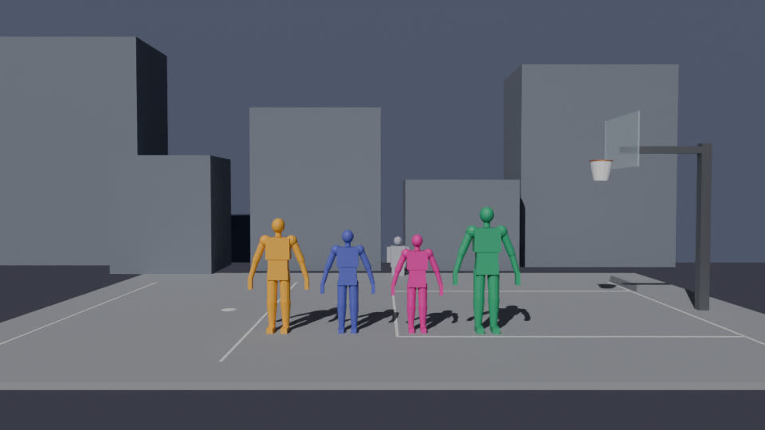

# Dunk Duel — Blender content pipeline

Python tools for Blender 4.x (`bpy`) that enforce the art conventions and move assets into the Unity
project. Every script runs headless:

```bash
blender -b <file.blend> -P Tools/Blender/<script>.py -- <args>
```

Add `--python-exit-code 2` so an uncaught Python exception also fails CI. Scripts exit `0` on success and `1`
on validation or input errors.

Tested headless with the `bpy` 4.5.15 LTS module (Python 3.11): the pure-Python rules in
`tests/test_conventions.py` and the end-to-end pipeline in `tests/test_bpy_pipeline.py` (see [Testing](#testing)).



## Scripts

| Script | What it does |
| --- | --- |
| `dd_conventions.py` | Single source of the rules: units, names, LODs, budgets, texture sets, bones, axis mappings, Unity folders. Pure Python, no `bpy`. |
| `dd_validate.py` | Checks a scene against the rules and writes a JSON report. |
| `dd_export.py` | Validates, then exports FBX files (plus textures and court layout manifests) into the Unity project. |
| `dd_lod.py` | Generates `_LOD1`/`_LOD2` for stage props with Decimate (collapse), keeping UVs and materials. |
| `dd_vat_bake.py` | Bakes vertex animation textures (EXR + JSON sidecar) for GPU-instanced crowds and writes the `VAT_ID` UV map. |
| `dd_graybox.py` | Generates rigged mannequins at roster heights and a graybox half court at sim dimensions. |
| `dd_bpy.py` | Shared `bpy` helpers (scope, layers, triangle counts, selection, texture nodes). |
| `tests/bpy_run.py` | Emulates `blender -b <file> -P <script> -- args` with the pip `bpy` module. |

### dd_validate.py

```bash
blender -b CH_Kofi.blend -P Tools/Blender/dd_validate.py -- --report out/kofi_validation.json [--collection CH_Kofi] [--graybox] [--strict]
```

Checks:

* metric units at scale 1.0, and 60 fps when the file has animation (frame-locked sampling);
* `CH_<Fighter>_<Part>` / `ST_<Court>_<Prop>` names with known tokens, LOD suffixes `_LOD0`–`_LOD2`, and no `.001` duplicates;
* applied rotation and scale (location may be non-zero for placed props), no negative scale;
* triangle budgets per fighter per LOD, per court layer, per court, and per prop, plus LOD chains (each level must be at most 75% of the previous one);
* fighter rigs: required bones, hierarchy, `Root` on top, at most 4 influences per vertex, no unweighted vertices;
* texture sets: `<Material>_<BaseColor|Normal|ORM|Emission>` names, at most 2K, power-of-two sizes, color spaces;
* UV maps and material assignment.

`--graybox` drops the 40k fighter target (a warning) for graybox files. `--strict` turns warnings into errors.

### dd_export.py

```bash
blender -b court.blend -P Tools/Blender/dd_export.py -- [--project <unity-root>] [--collection ST_TheTracks] \
    [--only CH_Kofi ST_TheTracks_Rim] [--graybox] [--force] [--no-validate] [--dry-run] [--report out/export.json]
```

* One FBX per fighter, `CH_<Fighter>.fbx`, in `Assets/DunkDuel/Art/Fighters/<id>/`. It holds the rig, every `CH_<Fighter>_*` mesh and LOD, and every action as a take. Animation is sampled each frame with curve simplification off, so frame-locked playback is exact.
* One FBX per stage prop group, `ST_<Court>_<Prop>.fbx`, containing its `_LODn` meshes, so Unity builds a LODGroup. These go to `Assets/DunkDuel/Art/Courts/<id>/`, or `Courts/shared/` for `ST_Shared_*` assets.
* `ST_<Court>_layout.json` per court lists each prop's FBX, depth layer, Unity-space pivot and triangle counts. Quality tiers toggle layers from it.
* Textures used by exported materials are copied to `<dest>/Textures/`.
* Validation errors abort the export (exit 1) unless `--force` is given.

`--project` defaults to the repository root, which is the Unity project root.

### dd_lod.py

```bash
blender -b props.blend -P Tools/Blender/dd_lod.py -- [--objects ST_TheTracks_Bench ...] [--collection ST_TheTracks] \
    [--ratios 1.0 0.5 0.25] [--keep-existing] [--save]
```

* The source becomes `<base>_LOD0`. Each LOD is a sibling object with the same transform, collections and material slots, and the Decimate result is applied.
* Default selection is every `ST_` prop at LOD0, except:
  * crowd meshes (the Crowd layer, shape keys, or a `VAT_ID` UV map), because each LOD would need its own VAT bake;
  * backdrop cards;
  * props under 64 triangles, which are already minimal.
* The chain stops before a level would drop below 24 triangles.
* Fighters are excluded: their LODs are authored by hand.

### dd_vat_bake.py

```bash
blender -b crowd.blend -P Tools/Blender/dd_vat_bake.py -- --object ST_Shared_CrowdA --start 1 --end 30 \
    --out Assets/DunkDuel/Art/Crowd --name crowd_cheer [--normals] [--max-width 2048] [--space stage|character] [--no-uv2] [--save]
```

* Samples the evaluated mesh (armature, shape keys and deform modifiers) on each frame. Topology must stay constant across frames.
* Positions are taken in object space, converted to Unity axes and normalized to the animation bounds. Normals are encoded as `n * 0.5 + 0.5`.
* Layout: one column per vertex and one row per frame. Width is the vertex count rounded up to a power of two, capped at `--max-width`. Wider meshes wrap over `rowsPerFrame` rows.
* Outputs: `<name>_pos.exr` (RGBA float), optionally `<name>_nrm.exr`, and `<name>.vat.json`, which holds frames, vertexCount, fps, textureWidth/Height, rowsPerFrame, boundsMin/Max, space and the file names.
* Writes a `VAT_ID` UV map as the second UV set, which Unity reads as `uv2`. It holds each vertex's texel center at frame 0. The shader samples `float2(uv2.x, uv2.y + frame * rowsPerFrame / textureHeight)` and decodes `lerp(boundsMin, boundsMax, rgb)`. Use `--save`, then export the mesh.

### dd_graybox.py

```bash
blender -b -P Tools/Blender/dd_graybox.py -- --out art/graybox_the_tracks.blend [--court-id the_tracks] \
    [--fighters kofi meera juno matas] [--no-court] [--no-fighters] [--lineup] [--render preview.png]
```

**Mannequins:**

* One per fighter at the exact roster height: Kofi 1.96 m, Meera 1.76 m, Juno 1.68 m, Matas 2.16 m. The top of the head equals the height.
* Hands, shoulders and calves are pushed +15% per the art direction.
* Each comes with a `CH_<Fighter>_Rig` armature carrying every required bone (rigid skinning) and an untextured `CH_<Fighter>_Mannequin_Graybox` material in the fighter's identity hue.
* Mannequins face `-Y` and stand at the origin. `--lineup` spreads them across the court for previews.

**Court:**

* Built in court space with the sim dimensions:
  * rim center (0, 3.05), radius 0.23;
  * backboard face at x = +0.38, 1.8 m wide, from 2.90 m to 3.95 m;
  * baseline at +1.6;
  * arc at −6.75, drawn as a line across the 8 m court depth;
  * free-throw line at −4.2;
  * check spot at −7.6;
  * left bound at −10.5.
* Objects sit in the depth-layer collections `ST_<Court>_PlayPlane`, `_MidGround` (low-poly blocks), `_Backdrop` (painted cards) and `_Crowd`.
* The Crowd collection holds an `ST_Shared_CrowdA` spectator with a keyed `Cheer` shape key (frames 1–30) to feed the VAT baker.
* Helpers (`_GameplayCamera`, `_KeyLight`) start with `_`, so the validator and exporter ignore them.

## Conventions

| Rule | Value |
| --- | --- |
| Units | Metric, scale 1.0 (meters); transforms applied (rotation 0, scale 1) |
| Animation | 60 fps, the sim tick rate; no curve simplification on export |
| Character names | `CH_<Fighter>_<Part>[_LODn]`, with Fighter one of `Kofi Meera Juno Matas`; rig `CH_<Fighter>_Rig` |
| Stage names | `ST_<Court>_<Prop>[_LODn]`, with Court a CamelCase token below or `Shared` |
| Courts | `MonsoonBazaar TheTracks ConcreteCoast` (street), `RivalryNight LightsOut CampusQuad` (school), `OldBarn GlassCourt TheCrown` (pro) |
| LODs | `_LOD0`, `_LOD1`, `_LOD2`; automatic prop ratios 1.0 / 0.5 / 0.25 |
| Fighter budget | LOD0 40–60k triangles per fighter (under 40k warns; over 60k fails), LOD1 ≤ 30k, LOD2 ≤ 12k |
| Court budgets | PlayPlane ≤ 120k, MidGround ≤ 40k, Backdrop ≤ 2k, Crowd ≤ 30k, court total ≤ 180k |
| Prop budgets | PlayPlane ≤ 20k, MidGround ≤ 6k, Backdrop ≤ 200, crowd instance mesh ≤ 1.5k |
| Textures | `<Material>_BaseColor` (sRGB), `_Normal` (Non-Color), `_ORM` (Non-Color, R = AO, G = roughness, B = metallic), optional `_Emission` (sRGB); ≤ 2048, power of two |
| Graybox materials | Names ending `_Graybox` may be untextured |
| Skeleton | `Root` (root motion), then Unity HumanBodyBones names: `Hips Spine Chest UpperChest Neck Head`, `Left/Right Shoulder UpperArm LowerArm Hand`, `Left/Right UpperLeg LowerLeg Foot Toes`; optional fingers, `Jaw`, eyes, `BallSocketLeft/Right` |
| Skinning | At most 4 influences per vertex; warns above 90 deform bones |

Mixamo, Rigify (`DEF-*`) and Blender metarig bone names are recognized, and the validator suggests the canonical rename.

### Axes

* **Sim and Unity gameplay space:** X toward the hoop, Y up, Z depth away from the gameplay camera.
* **Courts in Blender:** X toward the hoop, Z up, Y depth. Blender's front view (numpad 1) is the gameplay camera.
  * Stage FBX files export with `axis_forward='Z'`, `axis_up='Y'` and `bake_space_transform=True`.
  * This maps Blender `(x, y, z)` to Unity `(x, z, y)` with identity rotations and the same handedness as the game.
* **Characters** face Blender `−Y` and export with the standard `axis_forward='-Z'`, `axis_up='Y'`, so they face Unity `+Z`.
  * The axis conversion is left to Unity's **Bake Axis Conversion** import option, because baking it in Blender is unreliable with armatures.
  * Gameplay code turns fighters to face ±X.

## Unity import expectations

The Unity `AssetPostprocessor` applies settings by folder. Recommended settings:

* **`Assets/DunkDuel/Art/Fighters/<id>/`** (FBX):
  * Rig: Humanoid, with the avatar mapped from the canonical bone names and `Root` as the root-motion node.
  * Import: `bakeAxisConversion = true`, import cameras and lights off, `isReadable = false`.
  * Animation: compression off and curve resampling off, so clips sample exactly by sim frame through Playables. Root motion is baked to fixed-point curves at import.
  * Textures: max 2048. BaseColor and Emission in sRGB, Normal as a normal map, ORM linear. ASTC on mobile.
* **`Assets/DunkDuel/Art/Courts/<id>/`** (FBX + `ST_<Court>_layout.json`):
  * Static meshes. Generate lightmap UVs for PlayPlane and MidGround.
  * LODGroups come from `_LODn` siblings.
  * The layout JSON assigns layers that quality tiers can disable; Low tier uses card crowds.
* **`Assets/DunkDuel/Art/Courts/shared/`** and **`Assets/DunkDuel/Art/Crowd/`**:
  * Crowd meshes keep `uv2` (`VAT_ID`). **Do not** generate lightmap UVs on them; it would overwrite `uv2`.
  * VAT EXRs: sRGB off, mipmaps off, point filter, clamp, no compression (RGBA half), no non-power-of-two scaling. The `.vat.json` sidecar feeds the material.

## Testing

```bash
# Pure-Python rules (any Python 3.9+; the bpy tests skip themselves):
python3 -m unittest discover -s Tools/Blender/tests -p "test_*.py"

# Full pipeline with the bpy module (Blender 4.5 LTS wheels target Python 3.11):
uv venv --python 3.11 /tmp/bpy311 && uv pip install --python /tmp/bpy311/bin/python "bpy==4.5.*"
/tmp/bpy311/bin/python -m unittest discover -s Tools/Blender/tests -p "test_*.py" -v

# Run any script without a Blender install:
/tmp/bpy311/bin/python Tools/Blender/tests/bpy_run.py <file.blend|-> Tools/Blender/dd_validate.py -- --graybox
```

The pipeline tests cover:

* graybox heights and court dimensions;
* a clean validation, and a failing one with bad names, unapplied transforms, an over-budget prop, a missing bone and a misnamed 4K texture;
* texture-set export;
* the LOD chain and default selection;
* the VAT round trip (decoded positions within 2 mm, `VAT_ID` as the second UV set);
* FBX export, re-imported to confirm the rig bones, the 1.96 m height and the backboard placement;
* export refusal on validation errors.

## Known limits

* Linked duplicates export once per object. Instancing them through the layout manifest is a follow-up.
* Fighter LOD1 and LOD2 are authored by hand. `dd_lod` handles stage props only.
* The Unity side of the axis mapping (FBX right-handed to Unity left-handed by negating X) follows Unity's documented importer behavior. Here it is verified only through Blender export and re-import round trips; confirm once in the Editor with the graybox court (hoop at +X, backdrop at +Z).
